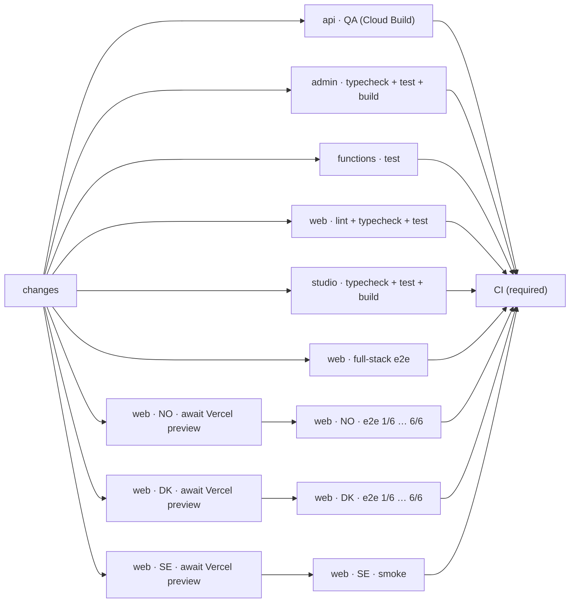

# CI and deploy workflows

Every push to a pull request starts one `CI` run (`.github/workflows/ci.yml`) whose graph shows
the whole platform: one lane per app and, for the websites, one lane per country. Deploys stay in
Cloud Build and Vercel.

## CI (pull requests)

- **`changes`** (`scripts/ci/changes.sh`) lists the pull request's files and decides which lanes
  it touches. Its summary shows, per lane, the first matching file or the paths it looked for. A
  lane without changes still runs and finishes within seconds as `<app> · no change`, so the graph
  never shows a lane as skipped.
- **`api · QA (Cloud Build)`** waits for the `QualityAssurance` check (`cloud.qa.yaml`: the API's
  typecheck and tests, Prettier and Oxlint on the whole repository) and mirrors its result, with a
  link to the Cloud Build log (`scripts/ci/await-check.sh`).
- **The Vercel lanes** wait for Vercel's preview of the commit (`scripts/ci/await-vercel.sh`): the
  commit status `Vercel – <project>`, then the URL from the GitHub deployment in
  `Preview – <project>`. When Vercel's Ignored Build Step skipped the build
  (`apps/web/vercel-ignore-build.sh`), the lane ends as `no web change`. A failed Vercel build
  fails the lane. The Cypress jobs run the site's suite against the preview
  (`.github/actions/cypress-deployment`, recorded in Cypress Cloud): NO and DK the e2e suites on
  6 machines, SE a smoke test (`cypress/e2e/se/smoke.js`: home page, a content page, the donate
  button leading to the external donation widget).
- **Dependabot and fork pull requests** get no Actions secrets, so their Cypress jobs finish as
  `e2e · no secrets on Dependabot PRs; full-stack e2e covers it`. The Vercel lanes still check
  that the previews build.
- **`CI (required)`** passes only when every lane passed and writes the run summary: every job
  with its result and duration, and links to the previews, the QA log and Cypress Cloud
  (`scripts/ci/summary.sh`).

`semgrep.yml` and `zizmor.yml` stay separate workflows: their check names (`semgrep/ci`,
`zizmor`) are among the required checks ([dependencies.md](dependencies.md#required-checks)),
and Semgrep also runs nightly. Preview environments (`preview.yml`, label `preview`) are separate
too: they run on `pull_request_target` with cloud credentials.

On `main`, `ci.yml` runs the same lanes after each merge, which keeps the caches pull requests
restore (pnpm store, Cypress binary, Next.js and tsc build caches); its Vercel lanes finish as
`production is tested by Deploy`. `web-ci.yml` tests the production deployments until the Deploy
workflow replaces it.
