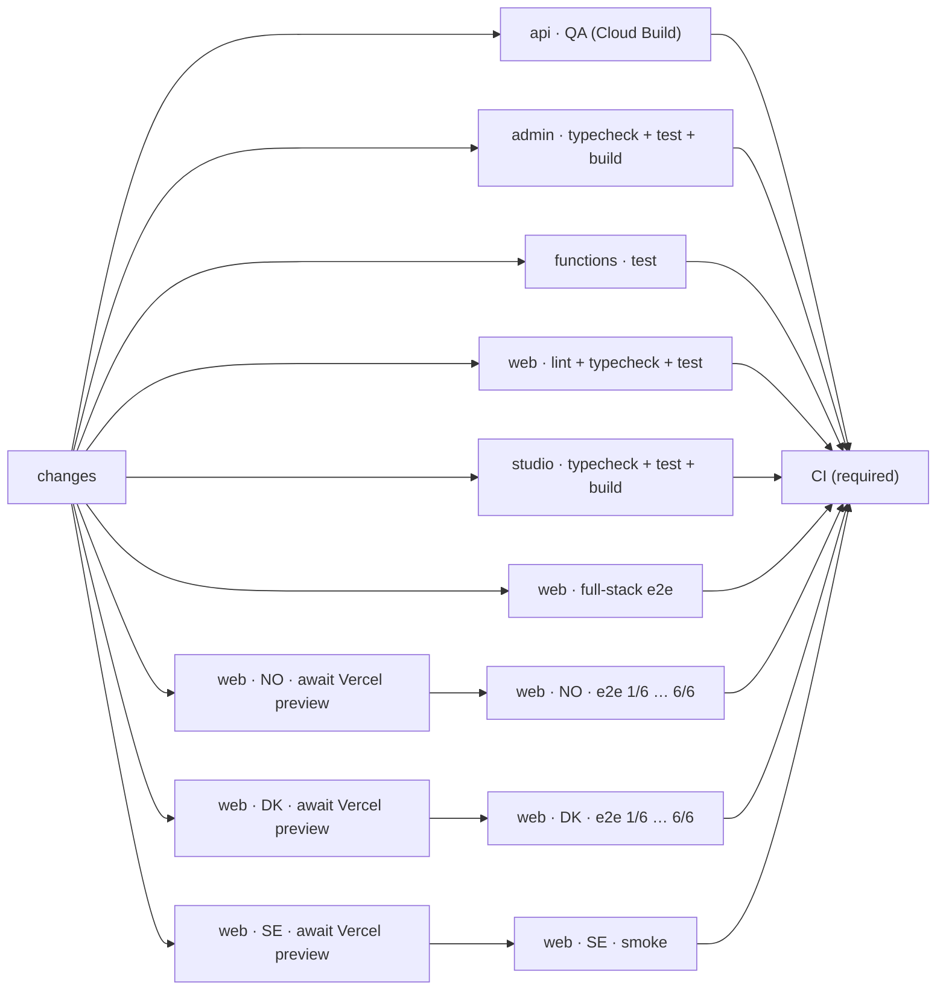
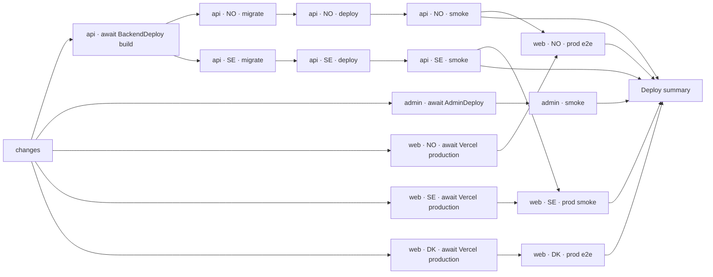

# CI and deploy workflows

Every push to a pull request starts one `CI` run (`.github/workflows/ci.yml`) whose graph shows
the whole platform: one lane per app and, for the websites, one lane per country. Deploys stay in
Cloud Build and Vercel.

Real runs to compare with:

| Run                                                                                                        | Shows                                                                                                                   |
| ---------------------------------------------------------------------------------------------------------- | ----------------------------------------------------------------------------------------------------------------------- |
| [CI on a website PR](https://github.com/stiftelsen-effekt/effekt-platform/actions/runs/41317238573)        | every lane running, with the NO and DK e2e shards and the SE smoke test against the previews                            |
| [CI on a Dependabot PR](https://github.com/stiftelsen-effekt/effekt-platform/actions/runs/41317750357)     | the Cypress lanes ending as `no secrets on Dependabot PRs; full-stack e2e covers it`                                    |
| [CI with no website change](https://github.com/stiftelsen-effekt/effekt-platform/actions/runs/41317280793) | the previews skipped by the Ignored Build Step (`no web change`)                                                        |
| [Deploy](https://github.com/stiftelsen-effekt/effekt-platform/actions/runs/41317590684)                    | an API deploy (step nodes without the step view, see below), the admin not deployed, production e2e for all three sites |

The run's summary page (below the graph) has the table of every lane with its result, duration
and links.

## CI (pull requests)

- **`changes`** (`scripts/ci/changes.sh`) lists the pull request's files and decides which lanes
  it touches. Its summary shows, per lane, the first matching file or the paths it looked for. A
  lane without changes still runs and finishes within seconds as `<app> · no change`, so the graph
  never shows a lane as skipped.
- **`api · QA (Cloud Build)`** waits for the `QualityAssurance` check (`cloud.qa.yaml`: the API's
  typecheck and tests, Prettier and Oxlint on the whole repository) and mirrors its result, with a
  link to the Cloud Build log (`scripts/ci/await-check.sh`).
- **The Vercel lanes** wait for Vercel's preview of the commit (`scripts/ci/await-vercel.sh`): the
  commit status `Vercel – <project>`, then the URL from the GitHub deployment in
  `Preview – <project>`. When Vercel's Ignored Build Step skipped the build
  (`apps/web/vercel-ignore-build.sh`), the lane ends as `no web change`. A failed Vercel build
  fails the lane. The Cypress jobs run the site's suite against the preview
  (`.github/actions/cypress-deployment`, recorded in Cypress Cloud): NO and DK the e2e suites on
  6 machines, SE a smoke test (`cypress/e2e/se/smoke.js`: home page, a content page, the donate
  button leading to the external donation widget).
- **Dependabot and fork pull requests** get no Actions secrets, so their Cypress jobs finish as
  `e2e · no secrets on Dependabot PRs; full-stack e2e covers it`. The Vercel lanes still check
  that the previews build.
- **`CI (required)`** passes only when every lane passed and writes the run summary: every job
  with its result and duration, and links to the previews, the QA log and Cypress Cloud
  (`scripts/ci/summary.sh`).

`semgrep.yml` and `zizmor.yml` stay separate workflows: their check names (`semgrep/ci`,
`zizmor`) are among the required checks ([dependencies.md](dependencies.md#required-checks)),
and Semgrep also runs nightly. Preview environments (`preview.yml`, label `preview`) are separate
too: they run on `pull_request_target` with cloud credentials.

On `main`, `ci.yml` runs the same lanes after each merge, which keeps the caches pull requests
restore (pnpm store, Cypress binary, Next.js and tsc build caches); its Vercel lanes finish as
`production is tested by Deploy`.

## Deploy (merges to main)

Every push to `main` starts one `Deploy` run (`.github/workflows/deploy.yml`). The deploys stay
where they are, in Cloud Build (BackendDeploy, AdminDeploy, [deploy.md](deploy.md)) and Vercel;
the workflow follows them read-only and tests what they deployed.

- **API.** `api · await BackendDeploy build` waits for BackendDeploy's check on the commit. The
  step nodes (`migrate`, `deploy` per country) each follow their Cloud Build step
  (`scripts/ci/cloudbuild-steps.sh`): they read the build through the Cloud Build API with a
  read-only identity. When the deploy guard skipped the build because a newer commit deploys
  (`scripts/deploy/guard.sh`), the nodes are named `· skipped (newer commit deploys)` and the
  smoke tests `· no deploy (newer commit deploys)`. When the commit doesn't touch the API (the
  trigger reports "Changed files did not match file filter"), they end as `· no change`.
- **API smoke** (`api · NO · smoke`, `api · SE · smoke`): `GET /` answers `status: ok` and the
  public tRPC call `widget.causeAreas` returns cause areas, on `data.gieffektivt.no` and
  `api.geeffektivt.se`.
- **Admin.** `admin · await AdminDeploy` mirrors the check; `admin · smoke` loads
  `admin.gieffektivt.no` and every asset its `index.html` references.
- **Websites.** Each site's lane waits for Vercel's production deployment of the commit, then
  runs its Cypress suite (`web-e2e.yml`) against production: NO on `gieffektivt.no` after the
  Norwegian API smoke (so a commit that changes both is tested against its own API), SE's smoke
  test on `geeffektivt.se` after the Swedish API smoke, DK on its deployment URL (Denmark's
  backend is separate). Production runs share the site and the Min Side test account: one at a
  time per site, and only the newest waiting one runs. GitHub cancels a replaced one, and the
  summary lists it as cancelled without failing the run. The `api-dev` deployments of
  giv-effektivt are not tested.
- **`Deploy summary`**: every job with its result and duration, and links to the Cloud Build
  logs, the Vercel deployments and Cypress Cloud.

### The read-only Cloud Build identity

`scripts/ci/gcp-deploy-observer.sh` (dry run by default, `--apply` to create) sets up:

| What                                                        | Access                                                                                                                                                         |
| ----------------------------------------------------------- | -------------------------------------------------------------------------------------------------------------------------------------------------------------- |
| Service account `effekt-deploy-observer`                    | `roles/cloudbuild.builds.viewer` (builds, steps, timing) and `roles/logging.viewAccessor` on one log view, `cloudbuild-deploy-observer`: Cloud Build logs only |
| Workload identity pool `github-effekt-deploy`, one provider | accepts only this repository (numeric id), `refs/heads/main`, `push`, and `job_workflow_ref` = `.github/workflows/deploy.yml@refs/heads/main`                  |
| Repository variables `DEPLOY_OBSERVER_WIF_PROVIDER`, `_SA`  | read by `deploy.yml`                                                                                                                                           |

It can't start, cancel or change builds, read secrets, or reach Cloud Run, Cloud SQL or storage.
Until the variables exist (or when the login fails), the API lane follows the whole build
through BackendDeploy's GitHub check in `api · await BackendDeploy build`, and the step nodes
end at once as `· see BackendDeploy (no step view)`; the guard's decision then isn't shown.

## Scripts

| Script                              | Used by                                                     |
| ----------------------------------- | ----------------------------------------------------------- |
| `scripts/ci/changes.sh`             | `changes` in both workflows                                 |
| `scripts/ci/await-check.sh`         | the QA, BackendDeploy and AdminDeploy nodes (GitHub checks) |
| `scripts/ci/await-vercel.sh`        | the Vercel nodes (commit statuses, deployments)             |
| `scripts/ci/vercel-lane.sh`         | the preview lanes in `ci.yml` (what the Cypress jobs skip)  |
| `scripts/ci/cloudbuild-steps.sh`    | the API step nodes in `deploy.yml` (Cloud Build API, logs)  |
| `scripts/ci/summary.sh`             | `CI (required)` and `Deploy summary`                        |
| `scripts/ci/gcp-deploy-observer.sh` | run by hand once: the read-only identity above              |
